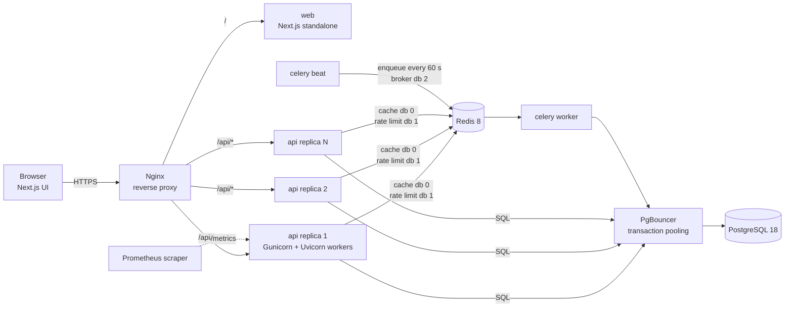
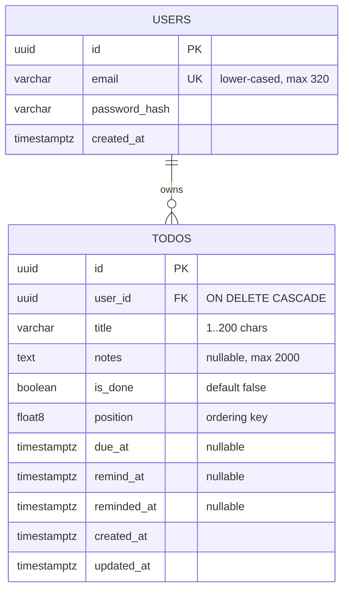
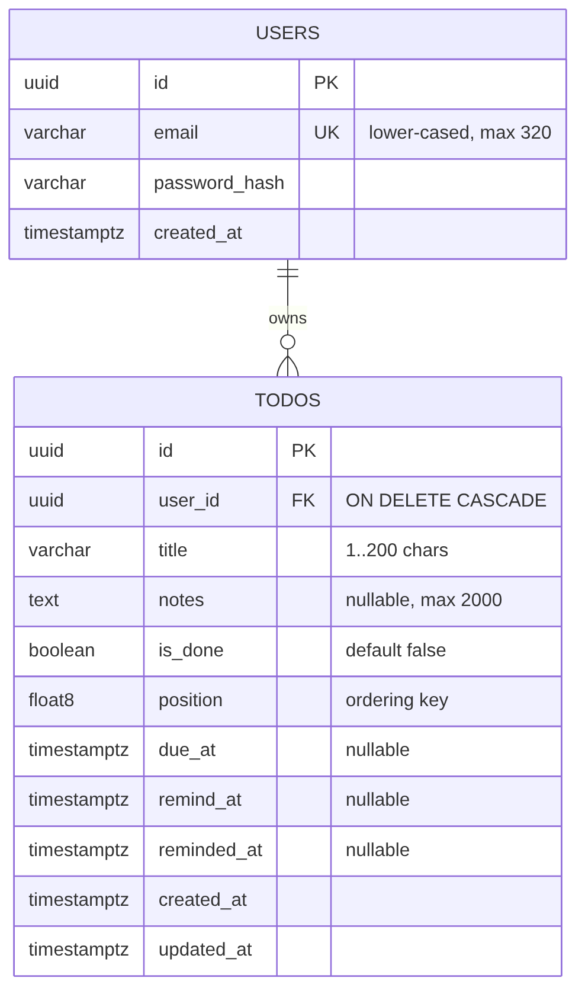
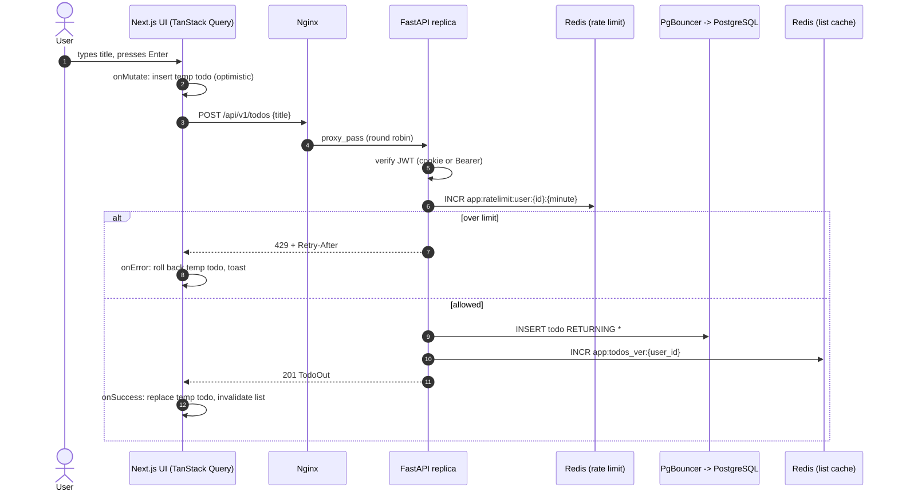
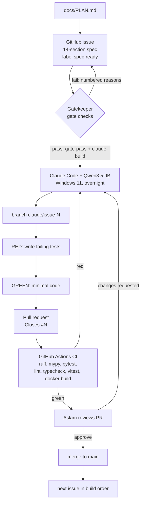
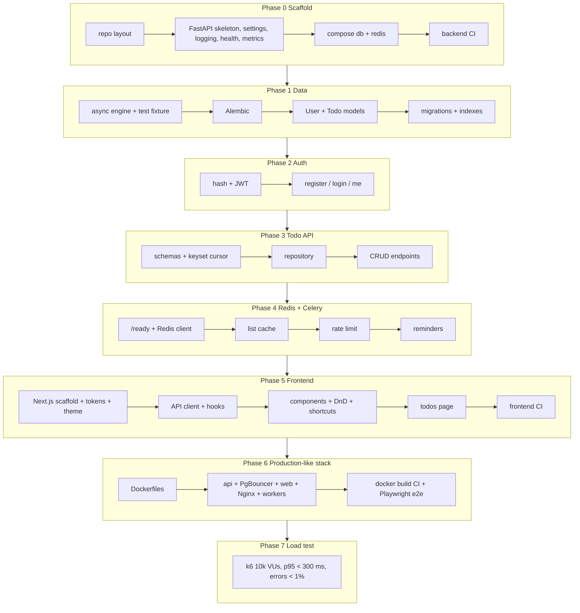

# TODO app for 10k concurrent users: build plan

Owner: Aslam Shaik. Builder: Claude Code with Qwen3.5 9B (Ollama) on Windows 11, one issue per night-run, branch `claude/issue-N`, tests first, then a PR.
Every issue follows the 14-section build-issue standard. This file is the single source of truth that every issue links to.

## 1. Goals
- A simple, pleasant TODO app: sign up, log in, add, edit, complete, reorder, delete todos, with optional due date and reminder.
- Designed for **10,000 concurrent users**. Target SLOs, **to be verified with k6** (not measured yet): p95 latency < 300 ms and error rate < 1% at 10k virtual users through Nginx.
- Horizontal scale by `docker compose up --scale api=N`; API containers keep no state.
- Every change lands through a small, test-first PR with CI green.

## 2. Non-goals
- Sharing todos between users, teams, comments, attachments.
- Email/push delivery of reminders (reminders are recorded and logged; delivery is a later decision).
- OAuth / SSO, password reset, refresh tokens.
- Kubernetes, multi-region, TLS termination inside compose.
- Offline mode.

## 3. Verified versions (checked 2026-10-27)
Python packages on PyPI; npm packages on the npm registry; image tags on Docker Hub. API usage confirmed in Context7 docs where marked.

| Area | Package | Version | Notes |
|---|---|---|---|
| API | fastapi | 0.162.0 | lifespan via `asynccontextmanager` (Context7) |
| API | uvicorn / uvicorn-worker / gunicorn | 0.54.0 / 0.4.0 / 26.2.0 | `uvicorn_worker.UvicornWorker` |
| DB | sqlalchemy[asyncio] | 2.1.6 | `create_async_engine`, `async_sessionmaker(expire_on_commit=False)`, `Mapped` (Context7) |
| DB | asyncpg | 0.32.0 | PgBouncer: `NullPool` + `prepared_statement_name_func` (Context7, SQLAlchemy docs) |
| DB | alembic | 1.20.1 | async template `alembic init -t async` |
| Validation | pydantic / pydantic-settings | 2.14.1 / 2.16.1 | |
| Cache | redis (redis-py) | 8.1.0 | `redis.asyncio`, `from_url`, `aclose()` (Context7) |
| Jobs | celery[redis] | 5.6.3 | reminders only |
| Auth | pyjwt / pwdlib[argon2] | 2.15.1 / 0.3.1 | HS256, Argon2 |
| Ops | structlog / prometheus-fastapi-instrumentator | 26.1.0 / 8.1.0 | |
| Tests | pytest / pytest-asyncio / httpx / asgi-lifespan | 9.1.1 / 1.4.1 / 0.28.1 / 2.1.0 | httpx `AsyncClient` does not run lifespan (Context7) |
| Lint | ruff / mypy | 0.17.3 / 2.4.0 | |
| Web | next / react | 16.4.3 / 19.3 | App Router, `next.config.ts` typed `NextConfig` (Context7) |
| Web | tailwindcss / shadcn CLI | 4.3.3 / 4.22.2 | |
| Web | @tanstack/react-query | 5.105.0 | optimistic updates via `onMutate` / `onError` rollback |
| Web | motion (Framer Motion) | 14.7.0 | `motion/react` |
| Web | @dnd-kit/core / sortable / utilities | 6.3.1 / 10.0.0 / 3.2.2 | |
| Web | next-themes / sonner / lucide-react | 0.4.6 / 2.0.8 / 1.62.0 | |
| Web tests | vitest / @testing-library/react / @playwright/test / @axe-core/playwright | 5.0.5 / 16.3.3 / 1.64.1 / 4.14.0 | |
| Images | postgres / redis / nginx | 18.6-alpine / 8.8.4-alpine / 1.30.6-alpine-slim | |
| Images | python / node / pgbouncer / k6 | 3.13.18-slim / 24.22.1-alpine / edoburu/pgbouncer:v1.26.1-p0 / grafana/k6:1.8.2 | |

Notes: create-next-app 16.4.3 installs TypeScript `^5` even though 7.0.2 is the latest on npm; the plan keeps what the generator installs.

## 4. Architecture

### Architecture




- **Nginx** is the only published port (8080). It routes `/api/*`, `/health`, `/ready` to `api`, everything else to `web`. It uses Docker DNS (`resolver 127.0.0.11`) so scaled replicas are picked up.
- **api**: FastAPI on Gunicorn with Uvicorn workers; stateless (JWT auth, no server sessions), so any replica serves any request.
- **PgBouncer** in transaction mode keeps Postgres connections bounded no matter how many replicas run.
- **Redis**: db 0 list cache, db 1 rate limiting, db 2 Celery broker, db 15 tests.
- **Celery**: one `beat` scans due reminders every 60 s; `worker`s mark them sent idempotently.
- **Observability**: JSON logs with `request_id`; `/metrics` (Prometheus, multiprocess mode) reachable only inside the network; `/health` (liveness) and `/ready` (DB + Redis).

## 5. Repository layout
```
backend/   pyproject.toml, uv.lock, Dockerfile, gunicorn.conf.py, alembic.ini, alembic/
  app/main.py
  app/core/{config,logging,request_id,metrics,security,cursor,ratelimit}.py
  app/api/{health,auth,todos,deps}.py
  app/db/{base,session}.py   app/models/{user,todo}.py   app/schemas/{auth,todo}.py
  app/repositories/{users,todos}.py   app/cache/{redis,todo_cache}.py   app/worker/{celery_app,tasks}.py
  tests/
frontend/  Next.js App Router app (app/, components/, hooks/, lib/, e2e/)
infra/     nginx/nginx.conf, postgres/init/01-create-databases.sql, tests/
loadtest/  k6/todos.js, k6/smoke.sh
scripts/   check_layout.py and its tests
docs/      PLAN.md, LOADTEST.md, images/
docker-compose.yml  .env.example  .github/workflows/ci.yml
```

## 6. Data model

### Entity relationship





Indexes:
- `ix_todos_user_id_position_id (user_id, position, id)`: serves the paginated list (the hottest query).
- `ix_todos_remind_pending (remind_at) WHERE reminded_at IS NULL AND remind_at IS NOT NULL`: partial index for the reminder scan.
- `uq_users_email`.

Ordering: `position` is a float. New todos get `max(position) + 1024`; a drag drop sets the midpoint of the two neighbours (one `PATCH`).

## 7. API contract (prefix `/api/v1`)
| Method | Path | Auth | Success | Errors |
|---|---|---|---|---|
| POST | /auth/register | - | 201 `UserOut` | 409 email taken, 422 |
| POST | /auth/login | - | 200 `TokenOut` + httpOnly cookie | 401 invalid credentials, 429 |
| POST | /auth/logout | - | 204 | |
| GET | /auth/me | yes | 200 `UserOut` | 401 |
| GET | /todos?cursor=&limit= | yes | 200 `{items, next_cursor}`, header `X-Cache` | 400 invalid cursor, 401, 422, 429 |
| POST | /todos | yes | 201 `TodoOut` | 401, 422, 429 |
| PATCH | /todos/{id} | yes | 200 `TodoOut` | 401, 404, 422, 429 |
| DELETE | /todos/{id} | yes | 204 | 401, 404, 429 |
| GET | /health, /ready, /metrics | - | 200 / 200 or 503 / text | |

Auth token: `Authorization: Bearer` first, else the `access_token` cookie (httpOnly, SameSite=Strict, Secure in prod). JWT HS256, 60 min.
Pagination: keyset; `limit` 1..100 (default 50); cursor = base64url of `position:id`.

### Create-todo sequence




## 8. Frontend UX and design direction
- **Feel**: calm and fast. One column, max width 640 px, generous spacing, neutral stone greys with a single indigo accent. Typography Geist Sans (UI) and Geist Mono (shortcut keys).
- **Colour tokens** (all text pairs computed ≥ 4.5:1, WCAG AA; lowest pair 5.02:1):

| Token | Light | Dark |
|---|---|---|
| bg | #FAFAF9 | #0B0B0F |
| surface | #FFFFFF | #16161D |
| fg | #1C1917 | #F5F5F4 |
| muted | #57534E | #A8A29E |
| accent | #5B4BDB | #A59BFF |
| accentFg | #FFFFFF | #0B0B0F |
| border | #E7E5E4 | #2A2A33 |
| success | #15803D | #4ADE80 |
| danger | #B91C1C | #F87171 |

- **Themes**: light, dark, system (next-themes, class strategy); toggle in the header.
- **Motion**: 150–250 ms; springs (stiffness 500, damping 35); animated check-mark draw; layout animation on reorder; all motion off under `prefers-reduced-motion`.
- **Optimistic UI**: create, toggle, edit, reorder, delete appear instantly; on error the change rolls back and a toast explains it. Delete shows an Undo toast for 5 s.
- **Keyboard**: `n` new, `j`/`k` move selection, `x` toggle done, `Delete`/`Backspace` delete, `?` help dialog. Ignored while typing. Drag-to-reorder also works with the keyboard (dnd-kit KeyboardSensor: Space, arrows, Space).
- **Empty state**: icon, "Nothing to do yet", hint "Press N to add your first task", and an Add button.
- **Accessibility (WCAG 2.1 AA)**: visible focus rings, labelled controls, `role="alert"` for errors, axe checks in Playwright for both themes.

## 9. Scaling strategy and capacity reasoning
All numbers below are **planning assumptions and targets**, to be confirmed or corrected by the k6 run in the load-test issue. None are measured.

- **Load model**: 10,000 concurrent users, each making one request every 1–2 s (k6 `sleep(1 + rand)`), gives roughly 10,000 / 1.5 ≈ **6,700 requests/s** at peak. Mix: 70% list, 20% create, 10% toggle.
- **Reads**: list pages are cached in Redis for 30 s with per-user version keys, so repeated reads skip Postgres; writes invalidate with a single `INCR`.
- **Writes**: about 2,000/s of small single-row INSERT/UPDATE statements through PgBouncer (40 server connections). Indexed by `(user_id, position, id)`.
- **API**: stateless replicas; start with `--scale api=4` × `WEB_CONCURRENCY=2` and increase until p95 meets the target or Postgres CPU saturates. Scaling decisions come from the k6 results, not this estimate.
- **Connections**: Postgres `max_connections=200`; PgBouncer `MAX_CLIENT_CONN=5000`, `DEFAULT_POOL_SIZE=40`; app uses `NullPool` behind PgBouncer.
- **Protection**: Redis fixed-window rate limits (120/min per user on todos, 10/min per IP on login); 429 with `Retry-After`. Fail open if Redis is down. Request body limit 64 KB at Nginx.
- **Pagination**: keyset, max 100 items, never OFFSET.
- **Known limit**: one k6 generator machine may itself saturate before 10k VUs; LOADTEST.md explains how to check this.

## 10. Testing strategy
- **TDD in every issue**: tests written first and run RED, including at least one negative-path test; then minimal code to GREEN.
- **Backend**: pytest + pytest-asyncio against real Postgres (`todo_test`, each test inside a rolled-back transaction) and Redis db 15. Migration tests use `todo_migrate`.
- **Frontend**: Vitest + Testing Library (jsdom); Playwright e2e + axe against the composed stack.
- **Infra**: pytest checks on `docker compose config` output, nginx.conf and the CI workflow file.
- **Load**: k6 smoke (20 VUs) in the issue; full 10k run by Aslam, results recorded in `docs/LOADTEST.md`.

## 11. CI (GitHub Actions)
`.github/workflows/ci.yml` jobs: **backend** (ruff check, ruff format --check, mypy, pytest with Postgres and Redis services), **frontend** (pnpm lint, typecheck, test, build), **docker** (compose config, build both images, no push).

### Build pipeline




## 12. Phased roadmap
- **Phase 0 Scaffold**: repo layout, FastAPI skeleton, settings, logging, health, metrics, compose db and redis, backend CI.
- **Phase 1 Data**: async engine and test fixture, Alembic, User and Todo models, migrations with indexes.
- **Phase 2 Auth**: hashing and JWT, user repository, register, login/logout, current user.
- **Phase 3 Todo API**: schemas and cursor, repository, CRUD endpoints.
- **Phase 4 Redis and Celery**: Redis client and `/ready`, list cache, rate limiting, reminder tasks.
- **Phase 5 Frontend**: Next.js scaffold, tokens, shadcn, themes, API client, hooks, components, drag-and-drop, shortcuts, page, frontend CI.
- **Phase 6 Production-like stack**: Dockerfiles, compose api/migrate, PgBouncer, web, Nginx, Celery services, docker CI, Playwright e2e.
- **Phase 7 Load test**: k6 at 10k VUs with thresholds.

### Clear image flow from start to end




## 13. Issue index (build order)
Every issue is labelled `phase-N`, one layer label and `spec-ready`. `claude-build` is added separately by the Gatekeeper.

| Issue | Title | Phase | Layer | Depends on |
|---|---|---|---|---|
| `S1` (number assigned on creation) | repository scaffold (layout checker, .gitignore, .editorconfig, .env.example) | 0 | infra | - |
| `B1` (number assigned on creation) | backend Python project skeleton (uv, FastAPI app factory, pytest) | 0 | backend | `S1` (number assigned on creation) |
| `B2` (number assigned on creation) | backend settings with pydantic-settings | 0 | backend | `B1` (number assigned on creation) |
| `B3` (number assigned on creation) | structured JSON logging (structlog) and X-Request-ID middleware | 0 | backend | `B2` (number assigned on creation) |
| `B4` (number assigned on creation) | GET /health liveness endpoint | 0 | backend | `B1` (number assigned on creation) |
| `B5` (number assigned on creation) | Prometheus /metrics endpoint | 0 | backend | `B4` (number assigned on creation) |
| `I1` (number assigned on creation) | docker compose `db` service (PostgreSQL 18.6) with test databases | 0 | infra | `S1` (number assigned on creation) |
| `I2` (number assigned on creation) | docker compose `redis` service (Redis 8.8.4) | 0 | infra | `I1` (number assigned on creation) |
| `CI1` (number assigned on creation) | GitHub Actions backend CI job (ruff, mypy, pytest with Postgres + Redis services) | 0 | ci | `B2` (number assigned on creation), `I2` (number assigned on creation) |
| `D1` (number assigned on creation) | async SQLAlchemy engine, session dependency and rollback test fixture | 1 | db | `B2` (number assigned on creation), `I1` (number assigned on creation) |
| `D2` (number assigned on creation) | Alembic async setup | 1 | db | `D1` (number assigned on creation) |
| `D3` (number assigned on creation) | `User` SQLAlchemy model | 1 | db | `D1` (number assigned on creation), `D2` (number assigned on creation) |
| `D4` (number assigned on creation) | Alembic migration 0001 create `users` | 1 | db | `D3` (number assigned on creation) |
| `D5` (number assigned on creation) | `Todo` SQLAlchemy model with indexes | 1 | db | `D3` (number assigned on creation) |
| `D6` (number assigned on creation) | Alembic migration 0002 create `todos` with indexes | 1 | db | `D4` (number assigned on creation), `D5` (number assigned on creation) |
| `A1` (number assigned on creation) | password hashing (pwdlib Argon2) and JWT helpers | 2 | backend | `B2` (number assigned on creation) |
| `A2` (number assigned on creation) | user repository (get by email, create) | 2 | backend | `D3` (number assigned on creation) |
| `A3` (number assigned on creation) | POST /api/v1/auth/register endpoint and auth schemas | 2 | backend | `A1` (number assigned on creation), `A2` (number assigned on creation) |
| `A4` (number assigned on creation) | POST /api/v1/auth/login (JWT + httpOnly cookie) and POST /logout | 2 | backend | `A3` (number assigned on creation) |
| `A5` (number assigned on creation) | `get_current_user` dependency and GET /api/v1/auth/me | 2 | backend | `A4` (number assigned on creation) |
| `T1` (number assigned on creation) | todo Pydantic schemas and keyset cursor encode/decode | 3 | backend | `D5` (number assigned on creation) |
| `T2` (number assigned on creation) | todo repository create and keyset list | 3 | backend | `T1` (number assigned on creation), `D6` (number assigned on creation) |
| `T3` (number assigned on creation) | todo repository get, update and delete (owner-scoped) | 3 | backend | `T2` (number assigned on creation) |
| `T4` (number assigned on creation) | GET and POST /api/v1/todos endpoints | 3 | backend | `T2` (number assigned on creation), `A5` (number assigned on creation) |
| `T5` (number assigned on creation) | PATCH and DELETE /api/v1/todos/{id} endpoints | 3 | backend | `T3` (number assigned on creation), `T4` (number assigned on creation) |
| `R1` (number assigned on creation) | async Redis client, lifespan wiring and GET /ready | 4 | backend | `B4` (number assigned on creation), `D1` (number assigned on creation), `I2` (number assigned on creation) |
| `R2` (number assigned on creation) | Redis cache for the todo list with version-key invalidation | 4 | backend | `R1` (number assigned on creation), `T5` (number assigned on creation) |
| `R3` (number assigned on creation) | Redis fixed-window rate limiting (todos per user, login per IP) | 4 | backend | `R1` (number assigned on creation), `A4` (number assigned on creation), `T5` (number assigned on creation) |
| `C1` (number assigned on creation) | Celery app and idempotent `todos.send_reminder` task | 4 | backend | `D6` (number assigned on creation), `I2` (number assigned on creation) |
| `C2` (number assigned on creation) | Celery beat task `todos.scan_due_reminders` every 60 s | 4 | backend | `C1` (number assigned on creation) |
| `F1` (number assigned on creation) | Next.js 16 App Router scaffold with Vitest | 5 | frontend | `S1` (number assigned on creation) |
| `F2` (number assigned on creation) | design tokens (light/dark) and WCAG contrast checker | 5 | frontend | `F1` (number assigned on creation) |
| `F3` (number assigned on creation) | shadcn/ui init and Button component | 5 | frontend | `F2` (number assigned on creation) |
| `F4` (number assigned on creation) | theme provider (next-themes) and theme toggle | 5 | frontend | `F3` (number assigned on creation) |
| `F5` (number assigned on creation) | typed API client and types | 5 | frontend | `F1` (number assigned on creation), `T5` (number assigned on creation) |
| `F6` (number assigned on creation) | TanStack Query provider and Toaster | 5 | frontend | `F4` (number assigned on creation) |
| `F7` (number assigned on creation) | auth form and /login page | 5 | frontend | `F5` (number assigned on creation), `F6` (number assigned on creation) |
| `F8` (number assigned on creation) | todo query hooks with optimistic updates and rollback | 5 | frontend | `F5` (number assigned on creation), `F6` (number assigned on creation) |
| `F9` (number assigned on creation) | position helper for drag-to-reorder | 5 | frontend | `F1` (number assigned on creation) |
| `F10` (number assigned on creation) | TodoItem component (checkbox, title, delete, animated check) | 5 | frontend | `F3` (number assigned on creation), `F2` (number assigned on creation) |
| `F11` (number assigned on creation) | AddTodo input | 5 | frontend | `F8` (number assigned on creation), `F3` (number assigned on creation) |
| `F12` (number assigned on creation) | EmptyState component | 5 | frontend | `F3` (number assigned on creation) |
| `F13` (number assigned on creation) | TodoList with dnd-kit drag-to-reorder (mouse and keyboard) | 5 | frontend | `F9` (number assigned on creation), `F10` (number assigned on creation) |
| `F14` (number assigned on creation) | keyboard shortcuts hook | 5 | frontend | `F1` (number assigned on creation) |
| `F15` (number assigned on creation) | shortcuts help dialog | 5 | frontend | `F14` (number assigned on creation), `F3` (number assigned on creation) |
| `F16` (number assigned on creation) | todos page composition (`/`) | 5 | frontend | `F7` (number assigned on creation), `F8` (number assigned on creation), `F11` (number assigned on creation), `F12` (number assigned on creation), `F13` (number assigned on creation), `F15` (number assigned on creation) |
| `CI2` (number assigned on creation) | GitHub Actions frontend CI job (lint, typecheck, test, build) | 5 | ci | `CI1` (number assigned on creation), `F1` (number assigned on creation) |
| `I3` (number assigned on creation) | backend Dockerfile and gunicorn.conf.py (Uvicorn workers) | 6 | infra | `R3` (number assigned on creation), `B5` (number assigned on creation) |
| `I4` (number assigned on creation) | compose `api` (scalable, no host port) and one-shot `migrate` service | 6 | infra | `I3` (number assigned on creation), `D6` (number assigned on creation) |
| `I5` (number assigned on creation) | PgBouncer (transaction pooling) between api and Postgres | 6 | infra | `I4` (number assigned on creation) |
| `I6` (number assigned on creation) | frontend Dockerfile (Next standalone) and compose `web` | 6 | infra | `F16` (number assigned on creation), `I4` (number assigned on creation) |
| `I7` (number assigned on creation) | Nginx reverse proxy (single entry, load balances api replicas) | 6 | infra | `I5` (number assigned on creation), `I6` (number assigned on creation) |
| `I8` (number assigned on creation) | compose Celery `worker` and single `beat` services | 6 | infra | `C2` (number assigned on creation), `I5` (number assigned on creation) |
| `CI3` (number assigned on creation) | CI job that builds both Docker images and validates compose | 6 | ci | `CI2` (number assigned on creation), `I7` (number assigned on creation) |
| `F17` (number assigned on creation) | Playwright end-to-end flow with axe accessibility check | 6 | test | `I7` (number assigned on creation), `CI3` (number assigned on creation) |
| `L1` (number assigned on creation) | k6 load test at 10k virtual users with p95 and error-rate thresholds | 7 | test | `I7` (number assigned on creation), `I8` (number assigned on creation) |

## 14. Open questions and risks
- Reminder delivery channel (email, push) is not chosen; reminders are only recorded and logged.
- PgBouncer image healthcheck: the issue includes a fallback if `pg_isready` is not in the image.
- Playwright e2e runs locally, not in CI, until Aslam decides to run the full stack in CI.
- Capacity numbers in section 9 are estimates until the k6 run.
